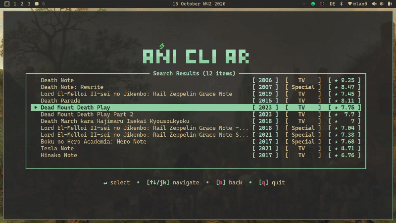

<div align="center">

  <p>
    <strong>Direct Terminal Anime Streamer & Batch Downloader</strong><br>
    Stream and download anime in high definition with Arabic & English subtitles directly from your terminal.
  </p>

  <p>
    <a href="https://paypal.me/np4abdou"></a>
  </p>

  <!-- Primary Release & Package Badges -->
  <p>
    <a href="https://github.com/np4abdou1/ani-cli-arabic/releases"></a>
    <a href="https://pypi.org/project/ani-cli-arabic"></a>
    <a href="https://aur.archlinux.org/packages/ani-cli-arabic"></a>
    
    <a href="LICENSE"></a>
  </p>

  <!-- CI/CD & Repo Activity Badges -->
  <p>
    <a href="https://github.com/np4abdou1/ani-cli-arabic/actions/workflows/ci.yml"></a>
    <a href="https://github.com/np4abdou1/ani-cli-arabic/actions/workflows/publish-pypi.yml"></a>
    <a href="https://github.com/np4abdou1/ani-cli-arabic/actions/workflows/publish-aur.yml"></a>
    <a href="https://github.com/np4abdou1/ani-cli-arabic/stargazers"></a>
    <a href="https://github.com/np4abdou1/ani-cli-arabic/network"></a>
  </p>

  <p>
    🌍 <strong><a href="README.ar.md">للتصفح باللغة العربية اضغط هنا</a></strong>
  </p>

  <hr />

  <!-- Quick Navigation Bar -->
  <p>
    <a href="#-whats-new-in-v20">🚀 What's New</a> &nbsp;•&nbsp;
    <a href="#-providers--ecosystem">🌐 Providers</a> &nbsp;•&nbsp;
    <a href="#-installation">📦 Installation</a> &nbsp;•&nbsp;
    <a href="#-usage--cli-guide">🎮 Usage</a> &nbsp;•&nbsp;
    <a href="#️-keyboard-shortcuts">⌨️ Shortcuts</a> &nbsp;•&nbsp;
    <a href="#️-configuration">⚙️ Config</a> &nbsp;•&nbsp;
    <a href="#-contributors">👥 Contributors</a>
  </p>

</div>

<br />

<div align="center">
  
</div>

---

## 🚀 What's New in v2.0?

Version **2.0** is the largest architectural overhaul in the project's history, engineered from the ground up for speed, reliability, and zero external bloat:

| Feature | Highlights |
| :--- | :--- |
| 🌐 **Multi-Provider Engine** | Stream seamlessly from **6 independent sources**: `Anime3rb`, `Anime Slayer`, `Animeify`, `HiAnime` (English Sub & Dub), `Stardima` (Arabic Dub), and `Stardima Kids` (Cartoons). |
| 📥 **Native Chunked Downloader** | Built from scratch with parallel chunked streaming, pause/resume, and live speed/ETA metrics — **zero external tools required** (no `aria2c` or `yt-dlp`). |
| ⚡ **Rebuilt Interactive CLI (`-i`)** | Organic `fzf` workflow with mouse navigation, zero Arabic RTL text clipping, and a quick episode action menu (`Play`, `Download`, `Batch`, `Quality`). |
| 🎬 **Universal Players & IPC** | Native support for **MPV**, **VLC**, **Celluloid**, **IINA**, and **Syncplay**. Real-time MPV JSON-IPC socket monitoring saves exact-second resume timestamps. |
| 🛡️ **Zero-Downtime Edge Routing** | Automatic 3-tier domain fallback chains across custom domains, Cloudflare Pages, and Cloudflare Workers. |
| 🔒 **Hardened Privacy** | Zero playback tracking and isolated development branches from health telemetry. |
| 🔄 **Cross-Platform Updater** | One-step automated updates across PyPI (`pip`), Arch Linux (`yay` / `paru`), and Homebrew. |

---

## 🌐 Providers & Ecosystem

Switch providers dynamically in the Settings menu (`[O]` / `[c]`) or directly via the `-p` CLI flag:

| Provider | CLI Key | Language | Stream Features |
| :--- | :---: | :---: | :--- |
| **Anime3rb** | `anime3rb` | 🇸🇦 Arabic Sub | High-speed direct CDN streams with multi-quality selection |
| **Anime Slayer** | `anime_slayer` | 🇸🇦 Arabic Sub | Official API endpoints with multiple backup episode servers |
| **Animeify** | `animeify` | 🇸🇦 Arabic Sub | Mirror servers with fast resolution switching |
| **HiAnime** | `hianime` | 🇬🇧 English Sub / Dub | Fast English subbed & dubbed streams with dynamic referer resolution |
| **Stardima** | `stardima` | 🇸🇦 Arabic Dub | Direct multi-server streams with automatic Arabic audio stream selection |
| **Stardima Kids** | `stardima_kids` | 🇸🇦 Arabic Dub | Dubbed cartoons and kids series, isolated from anime catalog |

---

## 📦 Installation

### 🔧 Prerequisites

Ensure the following core tools are installed on your system before launching:

* **Python 3.9+** (`3.10` – `3.12` recommended)
* **MPV** (Recommended default media player for real-time timestamp resume)
* **FFmpeg** (Required for stream multiplexing)
* **fzf** (Required for `-i` interactive CLI mode)

---

### ⚡ Option 1: PyPI via `pip` (Recommended — Linux, macOS, Windows)

```bash
# Install the latest stable release
pip install ani-cli-arabic

# Launch the full TUI or use the short alias
ani-cli-arabic
ani-cli-ar
```

<details>
<summary><b>🔄 How to upgrade via pip</b></summary>

```bash
pip install --upgrade ani-cli-arabic
```
</details>

---

### 🏹 Option 2: Arch Linux (AUR)

Available directly in the Arch User Repository for Arch, Manjaro, EndeavourOS, and Garuda:

```bash
# Using yay
yay -S ani-cli-arabic

# Using paru
paru -S ani-cli-arabic
```

---

### 🛠️ Option 3: Build from Source

Run the bleeding-edge development branch directly:

```bash
git clone https://github.com/np4abdou1/ani-cli-arabic.git
cd ani-cli-arabic
pip install -r requirements.txt
python3 main.py
```

---

## 🎮 Usage & CLI Guide

### 1️⃣ Full Terminal UI Mode (Default)
Launch the rich interactive dashboard with arrow-key navigation, themes, history, and favorites:
```bash
ani-cli-ar
```

### 2️⃣ Fast Interactive `fzf` Mode (`-i`)
Bypass the TUI and search/play directly from a lightweight `fzf` menu in English or Arabic:
```bash
# Search in English
ani-cli-ar -i "One Piece"

# Search in Arabic
ani-cli-ar -i "ون بيس"
```

### 3️⃣ Provider Selection via CLI (`-p`)
Target a specific streaming provider right from your terminal command:
```bash
# Stream from Anime3rb (Arabic Sub)
ani-cli-ar -p anime3rb "Naruto"

# Stream from HiAnime (English Sub/Dub)
ani-cli-ar -p hianime "Attack on Titan"

# Stream from Anime Slayer
ani-cli-ar -p anime_slayer "Bleach"

# Stream from Animeify
ani-cli-ar -p animeify "Jujutsu Kaisen"

# Stream Arabic-dubbed anime from Stardima
ani-cli-ar -p stardima "ناروتو"

# Stream Arabic-dubbed cartoons from Stardima Kids
ani-cli-ar -p stardima_kids "سبونج بوب"
```

### 4️⃣ Direct Query Search
Jump straight into search results inside the TUI:
```bash
ani-cli-ar "Hunter x Hunter"
```

---

## 🎯 Core Features Deep-Dive

<table>
  <tr>
    <td width="50%" valign="top">
      <h3>📥 Chunked Batch Downloader</h3>
      <ul>
        <li><b>Flexible Ranges:</b> Download full seasons or specific episodes (<code>1-12</code>, <code>1,3,5</code>, or <code>all</code>).</li>
        <li><b>Multi-Threaded:</b> Parallel chunked HTTP streams with automatic pause & resume support.</li>
        <li><b>Live Telemetry:</b> Real-time speed (MB/s), ETA, and visual progress bars.</li>
        <li><b>Self-Contained:</b> Zero external CLI download managers required.</li>
      </ul>
    </td>
    <td width="50%" valign="top">
      <h3>🎨 Modern TUI & Smart Features</h3>
      <ul>
        <li><b>17 Built-in Themes:</b> <code>blue</code>, <code>red</code>, <code>green</code>, <code>purple</code>, <code>cyan</code>, <code>gold</code>, <code>rose</code>, <code>sunset</code>, and more.</li>
        <li><b>Discord Rich Presence:</b> Displays live anime poster, title, and episode status on your profile.</li>
        <li><b>Smart Arabic Search:</b> Typo-tolerant normalization for <i>hamza</i>, <i>taa marbuta</i>, and Latinized titles.</li>
        <li><b>Watch Together:</b> Out-of-the-box <b>Syncplay</b> integration for watching with friends.</li>
      </ul>
    </td>
  </tr>
</table>

> ℹ️ *Classification metadata uses TMDB data; this product uses the TMDB API but is not endorsed or certified by TMDB.*

---

## ⌨️ Keyboard Shortcuts

<table>
  <tr>
    <th width="50%">🖥️ Main TUI Navigation</th>
    <th width="50%">🎬 Video Player (MPV)</th>
  </tr>
  <tr>
    <td valign="top">

| Key | Action |
| :---: | :--- |
| <kbd>↑</kbd> <kbd>↓</kbd> / <kbd>j</kbd> <kbd>k</kbd> | Navigate lists and menus |
| <kbd>Enter</kbd> | Search / Confirm choice |
| <kbd>e</kbd> / <kbd>m</kbd> | Latest Episodes / Movies |
| <kbd>t</kbd> / <kbd>p</kbd> / <kbd>r</kbd> | Trending / Popular / Top Rated |
| <kbd>g</kbd> / <kbd>s</kbd> | Browse Genres / Studios |
| <kbd>l</kbd> / <kbd>f</kbd> | Watch History / Favorites |
| <kbd>c</kbd> / <kbd>O</kbd> | Open Settings menu |
| <kbd>d</kbd> | Support project (Donate) |
| <kbd>B</kbd> | Go back to previous screen |
| <kbd>Ctrl+C</kbd> / <kbd>Q</kbd> | Quit application |

</td>
    <td valign="top">

| Key | Action |
| :---: | :--- |
| <kbd>Space</kbd> | Pause / Resume playback |
| <kbd>←</kbd> / <kbd>→</kbd> | Seek 5 seconds backward / forward |
| <kbd>[</kbd> / <kbd>]</kbd> | Decrease / Increase playback speed |
| <kbd>F</kbd> | Toggle fullscreen |
| <kbd>9</kbd> / <kbd>0</kbd> | Volume down / up |
| <kbd>Q</kbd> | Stop & save exact resume timestamp |

</td>
  </tr>
</table>

---

## ⚙️ Configuration

All user preferences are stored locally in:
```text
~/.ani-cli-arabic/database/config.json
```

Open Settings (<kbd>c</kbd> or <kbd>O</kbd>) from the main menu at any time to customize:
* **Active Provider**: Switch between `anime3rb`, `anime_slayer`, `animeify`, `hianime`, `stardima`, and `stardima_kids`.
* **Stardima Audio Language**: Choose `dub` (default), `sub`, or `both`.
* **Default Quality**: Lock in `1080p`, `720p`, `480p`, or `Ask` on every stream.
* **Media Player**: Select `mpv`, `vlc`, `celluloid`, `iina`, or `syncplay`.
* **Auto-Next Episode**: Automatically queue and play the next episode upon completion.
* **Discord Rich Presence**: Toggle live Discord status activity on or off.
* **Theme Color**: Preview and switch across 17 terminal color palettes instantly.
* **Download Directory**: Configure your custom local folder for batch downloads.
* **Analytics & Updates**: Toggle anonymous health telemetry or auto-update notifications.

---

## 👥 Contributors

Special thanks to everyone who has helped build, test, and maintain **ani-cli-arabic**:

<div align="center">
  <a href="https://github.com/np4abdou1/ani-cli-arabic/graphs/contributors"></a>
</div>

<br />

* **[@np4abdou1](https://github.com/np4abdou1)** — Creator & Lead Developer
* **[@Anas-Tou](https://github.com/Anas-Tou)** — Core Contributor
* **[@IsmailMechkene](https://github.com/IsmailMechkene)** — Core Contributor
* **[@ilyes-pro](https://github.com/ilyes-Pro)** — Core Contributor

> 💡 **Want to contribute?** Check out our [Contributing Guidelines](.github/CONTRIBUTING.md) — issues and pull requests are always welcome!

---

## 📄 License

Licensed under the **GNU General Public License v3.0**. See the [LICENSE](LICENSE) file for full details.

* ✅ Free for personal, educational, and community use
* ✅ 100% open-source and transparent
* ⚠️ Derivative works or forks must remain open-source under the **GPL-3.0** license

---

<div align="center">

  <h3>💖 Support This Open-Source Project</h3>
  <p>Your support helps cover infrastructure costs and keeps updates coming!</p>
  <a href="https://paypal.me/np4abdou"></a>

  <br /><br />

  Made with ❤️ by the Anime Open-Source Community

  <p>
    <a href="https://github.com/np4abdou1/ani-cli-arabic">⭐ Star Repo</a> &nbsp;•&nbsp;
    <a href="https://github.com/np4abdou1/ani-cli-arabic/issues">🐛 Report Bug</a> &nbsp;•&nbsp;
    <a href="https://github.com/np4abdou1/ani-cli-arabic/discussions">💬 Discussions</a>
  </p>

</div>
